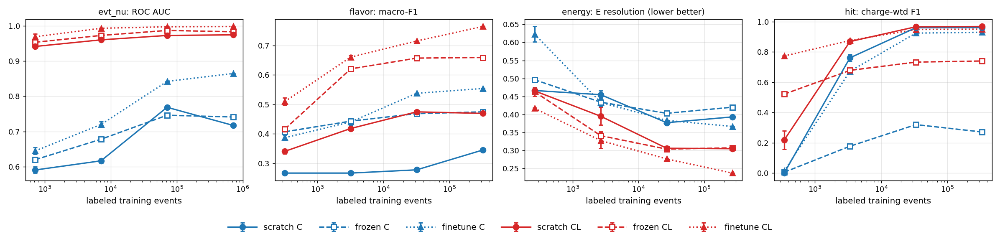
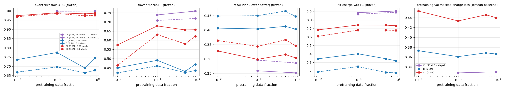

# Tech note — Round 1: a charge + light self-supervised foundation model for MicroBooNE open data

*Status: round-1 results. Code: branch `round1-prototype` of `HaiwangYu/fm4npp-lartpc`, package `multi-modal-qlmatch/qlfm`. Plan: `docs/plan-initial-round.md`. Working log: `docs/round1-log.md`. Review thread: GitHub issue #1.*

## 1. Summary

We pretrained a Transformer backbone with masked autoencoding (MAE). It reads TPC charge and PMT light as one token sequence. We pretrained on MicroBooNE overlay open data (≈831k events) without any truth labels. We then compared three ways of using it on four physics tasks:
- **frozen:** the backbone is fixed and only a small head is trained;
- **fine-tuned (FT):** the pretrained backbone and the head are trained together;
- **scratch:** the same network and head, trained from random initialization.

The four tasks are hit-level ν/cosmic tagging (T1), event-level ν/cosmic separation (T2), flavor νμCC/νeCC/NC (T3) and neutrino energy (T4). Each was run at labeled-data fractions of 0.1%, 1%, 10% and 100%, for charge-only (C) and charge+light (CL) inputs.

**Main findings:**

1. **Q1: does pretraining help?**
   - **Yes, most clearly with few labels.** With 0.1% labels (≈300–700 events), FT-CL beats scratch-CL on every task: T1 hit F1 0.77 vs 0.22; T2 AUC 0.97 vs 0.94; T3 macro-F1 0.51 vs 0.34; T4 resolution 42% vs 47%.
   - **Hits:** the gap closes by 1% labels, and from 10% on scratch is marginally better (0.967 vs 0.950).
   - **Event-level tasks:** FT stays ahead even at 100% labels (T3: 0.77 vs 0.47; T4: 24% vs 31%). Part of that advantage reflects the fixed downstream training budget, which leaves scratch undertrained; see §7.
2. **Q2: does light help?**
   - **Yes, a lot, and most for the event-level ν/cosmic task.** At 0.1% labels, CL reaches T2 AUC 0.94–0.97, against 0.59–0.65 for C.
   - **Low-label hit tagging is only possible with light.** At 0.1% labels, T1 F1 is 0.77 with CL and 0.01 with C. The in-time flash tells the model which charge cluster is the neutrino, which is the charge–light matching idea in learned form.
   - **CL-pretraining learned a non-trivial charge→light map.** With all 32 PMTs masked, it predicts the PMT time profiles at 0.56 × the mean-predictor error.
3. **Q3: pretraining-data scaling.**
   - With a fixed compute budget (≈4.4M events seen per run, 6.6M-parameter model), frozen-probe quality improves from 1% to 10% of the pretraining data, then **plateaus** (10% ≈ 50% ≈ 90%). The pretraining validation loss shows the same shape.
   - The model is compute- or capacity-limited at this scale rather than data-limited.
   - **With a 3× larger model (21M) and 2× steps (E6), data scaling reappears.** Pretraining on 90% beats 10% in all 9 non-saturated probe comparisons (flavor, energy, hits). The larger model is also much better overall: frozen hit F1 rises from 0.73 to 0.91, and frozen flavor at 10% labels from 0.66 to 0.76.
4. **Comparison with the Pandora and light-only reference baselines** (same events):
   - **T1 hits:** the best models reach charge-weighted F1 0.95–0.97, against 0.63–0.65 for Pandora's ν-slice hits.
   - **T2 events:** CL models reach AUC 0.97–0.999, against 0.82 for Pandora's `nu_score` and 0.91 for a beam-flash PE cut.
5. **One methodological finding about the pretraining objective:** with fixed-grid charge patches, the masked-patch reconstruction target is not learnable unless the decoder knows where the track crosses the patch (§3.3).

## 2. Data and tasks

### 2.1 Samples, cache and splits
- **Inclusive sample:** MicroBooNE BNB inclusive overlay, NoWire HDF5 (Zenodo 8370883). 18 files, 195 GB, 753,467 events.
- **νe sample:** the νe-CC overlay (Zenodo 7261921). 18 of 20 files, 77,340 events.
- **Merged corpus:** both samples together, 830,807 events.
- **Overlay:** both are simulated neutrinos on top of real off-beam cosmic data, so cosmic hits carry no MC truth.
- **Cache:** the HDF5 files were converted to a column-wise `.npy` cache (`qlfm.data.convert`; 146 GB for the inclusive sample).
  - Per hit: plane, wire, time, integral, rms, plus neutrino-deposited energy (truth), category, and the Pandora ν-slice flag (baseline only).
  - Per optical hit: channel, time, PE.
  - Per event: truth, the Pandora score, and the largest beam flash.
- **Splits:** hashed on (run, subrun), so events sharing an off-beam cosmic frame stay in one partition.

  | Split | Events | νe-sample share |
  |---|---|---|
  | train | 747,068 | 9.4% |
  | val | 41,912 | 9.2% |
  | test | 41,827 | 7.2% |

- **Pretraining subsets:** nested, at 1%, 10%, 50% and 90% (= the full train split) of all events.
- **Label pools:** nested, at 0.1%, 1%, 10% and 100% of train.

**Audit highlights** (inclusive sample):
- 15.4k hits per event (median).
- 44% of events have the ν vertex in the active volume (AV); 21% leave ≤5 ν hits.
- The beam flash comes 0.478 µs after the ν interaction time (5–95%: 0.457–0.507 µs).
- About 1% of optical hits lie outside the 23.4 µs beam window; they are dropped.

### 2.2 Downstream tasks (`qlfm/data/labels.py`)

| Task | Definition | Classes / counts (train) | Metric |
|---|---|---|---|
| T1 hit ν/cosmic | Per hit: ν if MC ν-deposit > 0.05 MeV. Evaluated on events with a visible in-AV ν | about 6% ν hits | charge-weighted F1, efficiency, purity |
| T2 event ν/cosmic | 0 = no ν charge (≤5 ν hits); 1 = visible in-AV ν (≥30 collection-plane ν hits); 2 = out-of-AV ν leaving >5 hits. Low-visibility in-AV events excluded | 142k / 333k / 241k | **AUC of class 1 vs class 0** (headline); in-AV vs out-of-AV AUC; macro-F1 |
| T3 flavor | Vertex in the fiducial volume (FV, 3 cm inside the AV) and visible ν. 0 = νμCC, 1 = νeCC, 2 = NC | 200k / 68k / 49k | macro-F1 |
| T4 energy | FV + visible ν + CC; regress log E_ν | 268k | resolution = half the 16–84% interval of (E_pred − E_true)/E_true |

**Reference baselines:**
- T1: Pandora hits in the slice with the highest `nu_score`.
- T2: Pandora max `nu_score` (AUC 0.82), and beam-flash PE in 3–6 µs (AUC 0.91).

## 3. Model

### 3.1 Tokenization: one token space for charge and light
- **Charge tokens.**
  - Each plane is cut into 16-wire × 64-tick cells; every occupied cell becomes one token. That gives about 2.0k tokens per event (median; 99th percentile 3.4k).
  - A shared hit MLP (relative wire and time, log q, rms) is max- and mean-pooled within the cell, then combined with the cell's hit count and total charge.
  - **Position:** the cell's charge-weighted centroid in physical units (drift x in cm, wire coordinate in cm). It is encoded with 10-octave Fourier features, plus an embedding of the centroid's offset inside the cell, plus a plane embedding.
  - Tokenization runs on the GPU from raw hits, so the cell size can change without rebuilding the cache.
- **Light tokens.**
  - 32 per event, one per PMT. Each carries log(1+PE) in 16 time bins over 0–24 µs (finer around the expected neutrino flash), plus total PE.
  - **Position:** Fourier features of the PMT (y, z) plus a PMT-ID embedding.
- A modality embedding is added to every token. The charge-only model simply has no light tokens.

### 3.2 Backbone and objective
- **Backbone:** a pre-LN Transformer: 8 layers, token width d=256, 8 attention heads of 32 dims each, MLP hidden size 1024; 6.6M parameters. E6 uses d=384, 12 layers, 6 heads (21M).
  - **Token size.** Every token, charge or light, is a 256-dim vector.
    - A charge token summarizes one occupied 16-wire × 64-tick cell, about 4.8 cm along the wire pitch by 3.5 cm of drift.
    - A light token summarizes one PMT's 17-number time profile.
  - **Sequence length.** About 2.0k charge tokens per event (median; 99th percentile 3.4k; cap 4096) plus 32 light tokens. During MAE pretraining the encoder sees only the ~40% unmasked charge tokens.
  - **Pre-LN.** LayerNorm is applied to the input of each sublayer, and the residual path is left untouched: `x = x + Attn(LN(x)); x = x + MLP(LN(x))`. The original "post-LN" Transformer instead normalizes after the residual add: `x = LN(x + Attn(x))`. Pre-LN is the standard in GPT, ViT and MAE because it trains more stably, especially in bf16 and with little warmup.
  - **No final LayerNorm.** Downstream heads read the encoder output without the final LayerNorm, following PoLAr-MAE.
  - **Packing.** Events are packed into variable-length sequences and run through FlashAttention-2 (`flash_attn_varlen`), so no compute is wasted on padding.
- **Masked autoencoder, charge:**
  - 60% of charge tokens are masked. Half of the masked budget comes from drift-time strips (256 ticks) masked jointly on all three planes, so the model cannot copy a hidden region from another plane's view.
  - The decoder (d=192, 3 layers) predicts, per masked cell, a 4×8 in-cell charge sub-grid plus the cell's log hit count and log total charge. Each target dimension is standardized within the batch.
- **Masked autoencoder, light:** per event, one of three modes:
  - mask about 50% of PMTs (p = 0.4);
  - mask all 32 PMTs (p = 0.4). This turns the task into predicting light from charge: a learned stand-in for a photon library plus flash matching;
  - mask nothing (p = 0.2).
- **Pretraining schedule:**
  - 17k steps at global batch 256 on one Polaris node (4× A100), about 45 min per run.
  - AdamW, lr 1.5e-4, 5% warmup, cosine decay, bf16.
  - The step count is the same for every pretraining fraction.

### 3.3 Finding: a fixed-grid MAE target needs patch centres
- **First version.** Tokens sat at cell centres. The masked-charge loss never beat a per-dimension mean predictor, while light reconstruction learned normally.
- **Diagnosis.**
  - The wiring was correct: a single-batch overfit test and a target-leak test both passed.
  - The position encoding was not the problem: Fourier, learned-grid and combined encodings all failed the same way.
  - A **non-neural baseline** settled it. Predicting a masked cell's (hit count, total charge) as the average of its visible neighbours is *worse* than predicting the global mean, at all tested cell sizes (8×32, 16×64, 32×128).
  - Reason: a track crosses a fixed grid at arbitrary offsets. Clipping a corner gives 1–2 hits; crossing the middle gives about 16. Without knowing where the track passes, a cell's content is unpredictable.
- **Fix.** This is why Point-MAE and PoLAr-MAE put patch centres on the data: each token is positioned at its charge centroid, plus the centroid's offset inside the cell.
- **Result.** Held-out masked-charge error drops to 0.61 × the mean baseline, from 0.97–0.99.

### 3.4 Heads and modes
- **Event-level tasks (T2–T4):** an attentive-pooling head, with 4 learned queries cross-attending over all tokens, then an MLP; about 0.5M parameters.
- **Hit-level task (T1):** a per-hit MLP on the hit embedding concatenated with its token's contextual feature.
- **Modes:**
  - scratch: random initialization, everything trained.
  - frozen: backbone fixed, only the head trained.
  - FT: everything trained, with layer-wise lr decay 0.75.
- **Downstream training, one GPU per run:**
  - Steps = 30 epochs of the labeled set, clipped to the range 400–15,000. Batch 32. Early stopping on a random val subset.
  - Test on a random test subset: up to 20k events (3k for T1).
  - 3 seeds at ≤1% labels.

## 4. Experiments and compute

| ID | Content | Runs |
|---|---|---|
| E1 | Scratch sanity runs (label pipelines) | 4 |
| E2 | Pretraining FM-C and FM-CL on 90% of the data | 2 |
| E3 | {scratch, frozen, FT} × {C, CL} × {0.1, 1, 10, 100%} labels × 4 tasks (×3 seeds at ≤1%) | 192 |
| E4 | Pretraining FM-C and FM-CL on 1%, 10%, 50% of the data; frozen probes at 1% and 10% labels | 6 + 48 |
| E5 | Checks: scratch lr scan (1e-4, 1e-3); hit fine-tuning with layer decay 0.9 | 8 |
| E6 | Larger model (21M params, 2× steps), FM-CL on 10% and 90%; frozen and FT probes | 2 + 24 |

E1 was run on the inclusive-only corpus, before the νe sample was merged in.

**Compute:** about 29 node-hours of the 100 budgeted (`figures/node_hours.md`; `sbank` charged 29.6 on suballocation `debug`). All on `debug` / `debug-scaling` with 1-hour jobs, submitted by a feeder (`scripts/feeder.sh`). Several single-GPU runs share each node through a lock-based task queue (`scripts/run_queue.sh`).

## 5. Results

### 5.1 E3: label efficiency (Q1) and the value of light (Q2)



Test-set metrics at 0.1% / 1% / 10% / 100% labels. Values at ≤1% are the mean of 3 seeds; the seed spread is typically ≤0.01 (full table: `figures/e3_summary.md`).

| Task (metric) | Mode | C | CL |
|---|---|---|---|
| T2 event ν (AUC) | scratch | 0.59 / 0.62 / 0.77 / 0.72 | 0.94 / 0.96 / 0.97 / 0.98 |
| | frozen | 0.62 / 0.68 / 0.75 / 0.74 | 0.95 / 0.97 / 0.99 / 0.98 |
| | FT | 0.65 / 0.72 / 0.84 / 0.87 | **0.97 / 0.99 / 1.00 / 1.00** |
| T3 flavor (macro-F1) | scratch | 0.27 / 0.27 / 0.28 / 0.35 | 0.34 / 0.42 / 0.48 / 0.47 |
| | frozen | 0.41 / 0.44 / 0.47 / 0.47 | 0.42 / 0.62 / 0.66 / 0.66 |
| | FT | 0.39 / 0.44 / 0.54 / 0.55 | **0.51 / 0.66 / 0.72 / 0.77** |
| T4 energy (resolution ↓) | scratch | 0.47 / 0.46 / 0.38 / 0.39 | 0.47 / 0.40 / 0.31 / 0.31 |
| | frozen | 0.50 / 0.43 / 0.40 / 0.42 | 0.46 / 0.34 / 0.30 / 0.31 |
| | FT | 0.62 / 0.43 / 0.38 / 0.37 | **0.42 / 0.33 / 0.28 / 0.24** |
| T1 hit (charge-wtd F1) | scratch | 0.00 / 0.76 / 0.96 / 0.96 | 0.22 / 0.87 / **0.97 / 0.97** |
| | frozen | 0.01 / 0.18 / 0.32 / 0.27 | 0.52 / 0.68 / 0.73 / 0.74 |
| | FT | 0.01 / 0.67 / 0.92 / 0.93 | **0.77 / 0.88** / 0.95 / 0.95 |

**Best-model detail at 100% labels (FT-CL):**
- **T2:** AUC 0.999. Signal efficiency is 0.997 at 95% and 0.973 at 99% background rejection. In-AV vs out-of-AV AUC 0.96. 3-class macro-F1 0.82.
- **T3:** νμCC efficiency 0.88, purity 0.92. νeCC efficiency 0.80, purity 0.72, AUC 0.96. NC efficiency 0.65, purity 0.63.
- **T4:** resolution 23.7%, bias −2.5%.
- **T1:** charge-weighted efficiency 0.948, purity 0.953. Pandora on the same events: 0.78 and 0.56.

**Interpretation:**
- **Pretraining wins clearly in the low-label regime**, and its advantage shrinks as labels grow. That matches the expected behaviour and Q1.
  - On T1, scratch catches up by 1% labels and slightly overtakes FT at ≥10%.
  - On the event-level tasks, FT-CL stays ahead even at 100% labels. Scratch there is limited by the downstream budget (≤15k steps, less than one epoch at 100%), so some of that gap is undertraining rather than pretraining value.
- **The frozen CL backbone is a strong general-purpose feature extractor for event-level tasks.** With only a small head trained, it matches or beats scratch at every budget on T2–T4.
- **Frozen features are weak for per-hit labels.** The MAE pretrains cell-level tokens, and the per-hit embedding gets no direct pretraining signal. This is especially bad for C (F1 ≤ 0.32).
- **Light is the dominant input for ν/cosmic separation**, at both the event and the hit level.
  - Charge-only models must find a small interaction among about 26 cosmic muons from topology and drift-window cues alone.
  - With light, the in-time PMT pattern points to the neutrino. This is the learned counterpart of Wire-Cell's charge–light matching.
  - Light also helps flavor and energy, adding calorimetric and timing information.
- **Charge-only from scratch fails on event-level tasks** at every tested learning rate (E5: flavor stays at the majority class; T2 AUC ≤ 0.77). The same architecture initialized from the C foundation model does learn: FT-C flavor 0.54, T2 AUC 0.87. Pretraining therefore turns an optimization problem the scratch model cannot solve into a learnable one.
- **Flavor shortcut check.** The νe sample supplies most νeCC training events, so a model could learn to recognize the sample instead of the flavor. On test events, νeCC efficiency is the same or higher for inclusive-sample νe (n=79) than for νe-sample events (FT-CL: 0.86 vs 0.80). We see no evidence of a sample shortcut.

### 5.2 E4: pretraining-data scaling (Q3)



Frozen-probe test metrics against the fraction of data used for pretraining (1%, 10%, 50%, 90%), at fixed pretraining compute:
- **CL improves from 1% to 10%.** At 1% labels: flavor 0.46 → 0.63, T1 0.61 → 0.68, T4 0.36 → 0.34, T2 0.968 → 0.986.
- **Then it is flat** within single-seed jitter of about ±0.02–0.04.
- **C is flat** throughout.
- **Pretraining validation loss** has the same shape: CL 0.453, 0.433, 0.446, 0.440; C 0.373, 0.361, 0.369, 0.366.
- **Interpretation.** Every run sees the same 4.4M events. With 10% of the data (83k events, about 53 epochs) a 6.6M-parameter model already saturates. More data needs more capacity and/or compute to pay off; E6 tests this.

### 5.3 E5: checks
- **Scratch-C learning rate.** At 10% labels, lr 1e-4 and 1e-3 give flavor 0.277 and 0.267 and T2 AUC 0.69 and 0.56. The default 3e-4 gives 0.277 and 0.77. The scratch failure is not an lr artifact.
- **FT layer decay 0.9 instead of 0.75 (T1).** At 0.1% labels: CL 0.788 (vs 0.773), C 0.001. At 10% labels: C 0.952 (vs 0.924), CL 0.960 (vs 0.948). This closes most of the gap to scratch (0.959 / 0.966). The default decay of 0.75 gave the per-hit embedding layers too small a learning rate; 0.9 should be the default for dense tasks.

### 5.4 E6: larger model, more compute (Q3 follow-up)
Model: d=384, 12 layers, 6 heads (21M parameters). It ran for 34k steps at global batch 256 (≈8.7M events, 2× E4), on one node, resuming across three 1-h jobs. Pretraining was CL only, on 10% and on 90% of the data.

**Pretraining validation loss** (× mean baseline):

| Model | Data | Masked charge | Masked light | Charge→light |
|---|---|---|---|---|
| S (6.6M) | 10% | 0.433 | 0.448 | 0.559 |
| S (6.6M) | 90% | 0.440 | 0.446 | 0.556 |
| M (21M, 2× steps) | 10% | 0.328 | 0.431 | 0.539 |
| M (21M, 2× steps) | 90% | 0.330 | 0.413 | 0.512 |

**Downstream test metrics** (CL; S = 6.6M from E3/E4, M = 21M):

| Probe | S 10% | S 90% | M 10% | M 90% |
|---|---|---|---|---|
| T2 AUC, frozen, 1% / 10% labels | 0.986 / 0.990 | 0.976 / 0.987 | 0.998 / 0.999 | 0.998 / 0.999 |
| T2 AUC, FT, 1% labels | — | 0.993 | 0.998 | 0.999 |
| T3 macro-F1, frozen, 1% / 10% labels | 0.631 / 0.678 | 0.622 / 0.657 | 0.708 / 0.738 | **0.719 / 0.759** |
| T3 macro-F1, FT, 1% labels | — | 0.663 | 0.724 | **0.741** |
| T4 resolution ↓, frozen, 1% / 10% labels | 0.344 / 0.299 | 0.346 / 0.304 | 0.296 / 0.259 | **0.286 / 0.252** |
| T4 resolution ↓, FT, 1% labels | — | 0.307 | 0.292 | **0.274** |
| T1 F1, frozen, 1% / 10% labels | 0.681 / 0.742 | 0.678 / 0.733 | 0.869 / 0.887 | **0.891 / 0.906** |
| T1 F1, FT, 1% labels | — | 0.875 | 0.925 | **0.943** |

**Interpretation:**
- **Capacity and compute dominate at this scale.** Going from S to M improves every probe substantially:
  - frozen T1 F1: +0.15 to +0.19;
  - frozen T3 macro-F1: +0.08 to +0.10;
  - T4 resolution: about −0.05.
- **Frozen M features are now competitive with fully trained models.** At 10% labels:

  | Model | T3 macro-F1 | T4 resolution |
  |---|---|---|
  | frozen M | 0.759 | 0.252 |
  | S fine-tuned, 100% labels | 0.765 | 0.237 |

- **Pretraining data now helps.** With M, 90% beats 10% in all 9 non-saturated comparisons: T3 +0.011 to +0.021; T4 −0.007 to −0.018; T1 +0.018 to +0.022. With S, the same comparisons were flat or reversed. T2 is saturated at AUC ≥ 0.998.
  - The improvement shows in the light and cross-modal objectives (charge→light 0.539 → 0.512). The masked-charge loss itself does not move (0.328 vs 0.330).
  - So the extra data mainly sharpens the learned charge–light correspondence.
- **Caveat:** single seeds, and differences of about 0.01–0.02. The consistent sign over 9 comparisons is the evidence. A fuller study needs more seeds and the 1% and 50% points with M.

## 6. Round-1 conclusion

The round's stopping criterion (plan §0) was: results are decent, the three comparisons make physical sense, or further iteration stops helping.

1. **Pretraining vs scratch.** The pretrained backbone is much better than scratch in the low-label regime, and the advantage narrows as labels grow. For per-hit labels it vanishes by about 1% labels, once fine-tuning uses a sensible layer decay.
2. **Charge + light vs charge only.** CL is better than C on every task, and decisively for ν/cosmic separation. The learned charge→light prediction is non-trivial.
3. **Pretraining-data scaling.** It is compute- and capacity-limited for the 6.6M model. It reappears, consistently, once model size and steps are increased (E6).
4. **Reference baselines.** The best models clearly beat Pandora and the beam-flash cut on the ν/cosmic tasks.

The obvious next gains come from scale and from objective and hit-level design, which are round-2 topics (§8), not from more tuning of this setup. Round 1 is therefore concluded.

## 7. Caveats and limitations
- **Overlay only.** Neutrinos are simulated on real cosmics. There is no beam-on data and no truly cosmic-only (beam-off) sample, so the T2 negatives are overlay events whose neutrino left no charge.
- **Beam-window light only** (23.4 µs). Out-of-time cosmics have no flash information, so this is not the full 4.8 ms charge–light matching of Wire-Cell.
- **Single seed at 10% and 100% labels, and in E4.** Differences below about 0.02 are not significant.
- **Fixed downstream budget** (≤15k steps × 32 events). Scratch at large label budgets is not trained to convergence, so the "pretraining helps at 100%" result on event-level tasks is partly a budget effect.
- **Small models.** 6.6M parameters (21M in E6) and a few-million-event pretraining budget, set by the 100 node-hour allowance.
- **The νe sample is mixed into all splits** (review decision), so T3 class proportions are not natural.
- **Label definitions** (thresholds in `labels.py`) are operational choices. A hit counts as "neutrino" if its MC ν-deposit exceeds 0.05 MeV, which can include tiny MC deposits on top of cosmic pulses.

## 8. Next steps (round 2 candidates)
1. **Hit-level representation.**
   - The larger model already lifts frozen T1 F1 from 0.73 to 0.91, and layer decay 0.9 lets fine-tuning match scratch.
   - Next: add a per-hit pretraining signal (hit-level masked prediction, or dense self-distillation, Panda/Sonata-style), and try finer cells.
2. **Self-distillation (stage B).** An iBOT/JEPA latent objective to strengthen frozen features, compared against MAE at matched compute.
3. **Scaling.** Grow model size and pretraining compute together (E6: capacity and compute are the main lever at this scale, and once capacity grows the data starts to matter, mostly through the charge–light objective). Add seeds to the probes for error bars.
4. **Backbone ablation.** FM4NPP-style per-hit tokens with a Mamba2 backbone (needs `mamba_ssm` built on Polaris).
5. **Physics realism.** Request beam-off samples. Add interaction-level (slice) heads. Compare against Wire-Cell's generic ν selection at matched efficiency.

## 9. Reproducibility
```bash
source multi-modal-qlmatch/scripts/env.sh
# data
$PY scripts/download_zenodo.py 8370883 $QLFM_DATA/bnb_nowire --jobs 18   # (+ download_ranges.py for parallel ranges)
qsub scripts/pbs/convert.pbs                                             # -> $QLFM_WORK/cache/{bnb,nue}
$PY scripts/make_splits.py $QLFM_WORK/cache/bnb,$QLFM_WORK/cache/nue $QLFM_WORK/cache/splits_all.npz
# pretraining (1 node): qsub -q debug -l select=1:system=polaris -l walltime=01:00:00 \
#   -v OUT=$QLFM_WORK/pre/cl_f0.90,ARGS="--light 1 --subset pre_f0.90 --steps 17000 --bs 64" scripts/pbs/pretrain.pbs
# downstream: scripts/make_tasks.py e3 ... > tasks.txt; jobs via scripts/feeder.sh + scripts/pbs/queue.pbs
$PY scripts/summarize.py $QLFM_WORK/e3; $PY scripts/plot_scaling.py $QLFM_WORK docs/figures/e4_scaling.png
```
Outputs: `/lus/eagle/projects/neutrinoGPU/yuhw/fm4npp-lartpc-work/{pre,e3,e4,e5,e6}`. Node-hour accounting: `scripts/usage.sh <job ids>`.
