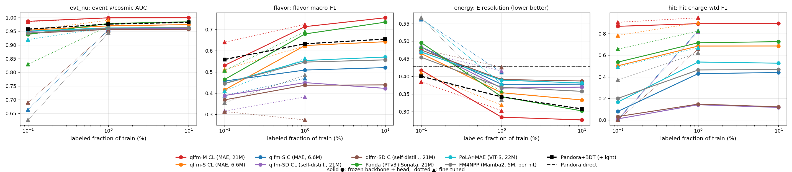

# Tech note — Round 2: comparison with reference algorithms

*Status: round-2 results. PDF version with algorithm parameter tables and 80 event displays: `docs/technote-round2.pdf`. Code: branch `round2-references` of `HaiwangYu/fm4npp-lartpc`. Plan: `docs/plan-round2.md`. Survey: `docs/round2-survey.md`. Working log: `docs/round2-log.md`. Tracking: GitHub issue #3. Round 1: `docs/technote-round1.md` and `.pdf`.*

## 1. Summary

Round 2 compared our charge+light MAE foundation model (qlfm) against the reconstruction in the MicroBooNE open data (Pandora) and against four published foundation-model recipes. All are adapted to our data and given equal pretraining node-hours, and evaluated with identical heads, late-fused light, label budgets and test subsets. Round 2 used **37.6 node-hours** of the 50 budgeted for the comparison, plus 1.1 for the event-display inference and the Panda fine-tune re-run (38.7 in total).

1. **qlfm-M (multi-modal MAE, 21M) is the best model on all four tasks once ≥1% of labels (about 3–7k events) are available.** With a frozen backbone at 1% / 10% labels:

   | Task | qlfm-M | Best other FM (Panda) | Pandora + BDT (+ light) |
   |---|---|---|---|
   | T2 event ν/cosmic, AUC | **0.999 / 0.999** | 0.978 / 0.984 | 0.976 / 0.983 |
   | T3 flavor, macro-F1 | **0.713 / 0.755** | 0.679 / 0.734 | 0.632 / 0.655 |
   | T4 energy resolution (lower is better) | **0.284 / 0.276** | 0.343 / 0.302 | 0.342 / 0.308 |
   | T1 hit, F1 | **0.892 / 0.894** | 0.715 / 0.725 | (Pandora ν slice: 0.63–0.65) |

2. **With very few labels (0.1%, about 300–700 events), the Pandora + BDT reference is competitive.**
   - Frozen, it beats every frozen foundation model on flavor (0.56 vs 0.53 for qlfm-M) and on energy (0.400 vs 0.418).
   - Fine-tuning qlfm-M overtakes it: flavor 0.640, energy 0.385.
   - Reconstruction features are a strong low-label prior.
3. **Panda (PTv3 + Sonata self-distillation, size-matched 21M) is the strongest external recipe** and has the best *charge-only* representation:
   - T2 is still 0.914 without any light, against 0.67–0.71 for the other charge-only backbones.
   - In the hit task (T1) it matches or beats Pandora's ν-slice hits from 1% labels (0.715).
4. **PoLAr-MAE and FM4NPP land between qlfm-S-C and qlfm-S-CL.**
   - With late light they reach T2 AUC 0.96.
   - Their *frozen* flavor and energy results are below Pandora + BDT.
   - On hits they stay below Pandora's ν-slice hits (0.46–0.54 at 1% labels).
   - FM4NPP was run at its m3 size (4.9M parameters), about 4× smaller than the others.
5. **Light matters for every backbone.** Adding the identical late-fused light raises charge-only T2 from 0.61–0.91 to 0.96–0.98. qlfm's early fusion, with light inside the backbone, goes further: 0.999.
6. **qlfm-SD**, our Panda-v2-inspired self-distillation on qlfm tokens, **underperforms the MAE objective** on the same backbone (frozen T1 ≤ 0.15; T3 ≈ 0.44). The likely cause is its inherited low learning rate. Panda's own recipe on its PTv3 backbone works well.

## 2. What was compared

All methods use the same data, splits, tasks, metrics and test subsets as round 1. The tasks are T1 hit ν/cosmic, T2 event ν/cosmic (3-class; headline AUC is in-AV ν vs no-ν), T3 flavor and T4 energy.

**What T4 regresses.** The target is the **true incoming neutrino energy E_ν** (generator truth, `event_table/nu_energy`), for CC events with a visible ν and a fiducial vertex. It is *not* the deposited energy.
- The ν's MC energy deposited on collection-plane hits is a median 47% of E_ν (44% νμCC, 57% νeCC).
- A log-linear calibration of that true deposit to E_ν gives a resolution of only 0.36. The best models reach 0.28, so they also use topology, not just calorimetry.

### 2.1 Reconstruction already in the open data (Pandora)
- **Pandora direct.** Untrained Pandora outputs from the HDF5 files:
  - T1: hits in the ν slice, i.e. the slice with the highest `nu_score`.
  - T2: maximum `nu_score`.
  - T3: the `slice_pdg` hypothesis (14 → νμCC, 12 → νeCC, no ν slice → NC/other).
  - T4: calorimetric energy, a linear fit (in log) to the summed collection-plane charge of the ν slice.
- **Pandora + BDT.** A `HistGradientBoosting` model on 32 per-event Pandora features: best-slice score, flavor hypothesis, flash-match score, vertex, PFP/track/shower counts and `trkshr` statistics, slice and PFP hits and charge per plane, and slice extents.
  - The "+ light" variant adds 8 summary features of the beam flash: PE, time, y/z centroid and width, and slice–flash Δz.
  - It is trained at the same label pools, seeds and test subsets as the neural models. This is the classic "reconstruction + ML" analysis baseline.
- **art/ROOT reconstruction not used.** The richer art/ROOT reconstruction (Pandora calorimetry and PID) needs LArSoft and streaming 6.4 TB over xrootd, so it was left out.

### 2.2 Foundation-model references
None of the four methods has seen 2D wire hits, real cosmic data or LArTPC light. All adaptations below are new.

| Method | Implementation | Input on our data | Deviations from the published method (forced by the data) |
|---|---|---|---|
| **FM4NPP** (arXiv 2508.14087) | Port of the released `MambaGPT` onto `mamba_ssm`. d = 256, 12 layers, d_state 16, causal Mamba2. Fixed random energy projection plus NeRF position embedding. k-NNN regression with k = 30. lr 2e-4, wd 0.01, clip 0.1 | One token per wire hit (about 14.5k per event, no cap) | Time-major hierarchical raster (8 drift slabs × 3 interleaved planes × 8 wire boxes). Neighbours restricted to the same plane. **Relative** in-plane offsets as targets (absolute targets were trivially solvable here). fp32 output head. No density reweighting |
| **Panda** (arXiv 2512.01324) | `pimm` Sonata-v1m1 + PT-v3m2. 2 global + 6 local views; masking ramp 0.5→0.9; 4,096 prototypes with Sinkhorn; EMA 0.994→1 | Per-plane 2D clouds: points (wire cm, drift cm, plane·10 cm), energy = hit integral, 3 mm grid | Size-matched to 21M (depths 2,2,2,4,2; channels 32–320) instead of 91M. In-plane augmentations only. Mask patches rescaled to the same physical size |
| **PoLAr-MAE** (arXiv 2502.02558) | `pimm` PoLAr-MAE: ViT-S (22M), C-NMS ball groups, 60% random masking, Chamfer + per-point energy loss, fp32 | Same per-plane clouds; each hit is a point | Ball radius 4 cm with up to 1,024 groups (published 1.5 cm). A 10 m × 3.5 m plane with about 26 cosmic tracks would need about 2k groups at 1.5 cm |
| **Panda v2** (arXiv 2609.00611) | *Not reproducible*: no code, and key hyperparameters are unpublished. We test **qlfm-SD**, Panda-style self-distillation on qlfm cell tokens (21M), with Panda v2's design hint applied: drop masked tokens and distil only observable ones | qlfm cell + PMT tokens | Our variant, not Panda v2. It inherited MAE's batch-scaled learning rate (about 1.9e-5 at batch 32), about 3× below the usual DINO scaling |

### 2.3 Fairness protocol
- **Equal pretraining node-hours.** Every reference gets about 4 node-hours: four chained 1-hour jobs on one 4×A100 node, about 3.5 h of training. Schedule lengths are set from measured throughput. qlfm-M got about 2 node-hours and qlfm-S about 0.75.

  | Model | Seen in pretraining |
  |---|---|
  | FM4NPP | 2.05M events (about 30G tokens) |
  | Panda | 1.84M plane-clouds (about 0.6M events) |
  | PoLAr-MAE | 5.0M plane-clouds (about 1.7M events) |
  | qlfm-SD | about 2.0M events |
  | qlfm-M (MAE) | 8.7M events |

- **Identical heads.** Attentive pooling for T2–T4 and a per-hit MLP for T1, on each backbone's features:
  - Panda: per-hit features from the up-cast teacher backbone.
  - PoLAr-MAE: the nearest group token.
  - FM4NPP: a learned mix of all 12 layers, as in FM4NPP's own adapters.
- **Identical late-fused light.** Every backbone gets the same PMT light encoder in the head. qlfm-CL additionally has light inside its backbone (early fusion), which is our proposal.
- **Downstream protocol R2P.** Identical for every backbone:

  | Mode | Label budgets |
  |---|---|
  | frozen | 0.1% (2 seeds), 1%, 10% |
  | fine-tuned (layer decay 0.9) | 0.1%, 1% |
  | charge-only frozen diagnostic | 1% |

  - Step cap 3,000; test subsets of 10k events (3k for T1).
  - The heavy backbones use gradient accumulation (4 micro-batches of 8), which gives the same optimizer step as batch 32.
  - The protocol is smaller than the plan's because point-cloud and per-hit backbones cost 10–30× more per step than qlfm cell tokens.

## 3. Results

*Solid ● frozen backbone + head; dotted ▲ fine-tuned; black dashed: Pandora + BDT (+ light); dash-dot: Pandora direct. Full tables with seed spreads: `figures/round2_comparison.md`.*

### 3.1 T2: event-level ν/cosmic (AUC; frozen at 0.1 / 1 / 10%; FT at 0.1 / 1%; charge-only frozen diagnostic at 1%)

| Method | Frozen 0.1% | Frozen 1% | Frozen 10% | FT 0.1% | FT 1% | Charge-only diag |
|---|---|---|---|---|---|---|
| **qlfm-M CL (MAE, 21M)** | **0.986** | **0.999** | **0.999** | **0.985** | **0.998** | 0.999 |
| qlfm-S CL (MAE, 6.6M) | 0.953 | 0.970 | 0.974 | 0.953 | 0.990 | 0.972 |
| qlfm-S C (MAE, 6.6M) | 0.943 | 0.960 | 0.962 | 0.664 | 0.956 | 0.666 |
| Panda (21M) | 0.938 | 0.978 | 0.984 | 0.830† | 0.968† | 0.914 |
| PoLAr-MAE (22M) | 0.950 | 0.962 | 0.963 | 0.920 | 0.964 | 0.660 |
| FM4NPP (4.9M) | 0.943 | 0.961 | 0.963 | 0.626 | 0.944 | 0.712 |
| qlfm-SD CL / C (21M) | 0.949 / 0.942 | 0.959 / 0.957 | 0.959 / 0.957 | 0.940 / 0.690 | 0.959 / 0.952 | 0.605 / 0.609 |
| Pandora + BDT C / + light | 0.926 / 0.957 | 0.949 / 0.976 | 0.955 / 0.983 | | | |
| Pandora direct (`nu_score`) | 0.826 | | | | | |

*† Panda FT: re-run with a trainable backbone (see §5). "Charge-only diag" drops the late-fused light. qlfm-CL backbones still contain light internally, so for them it is not charge-only.*

### 3.2 T3: flavor νμCC / νeCC / NC (macro-F1)

| Method | Frozen 0.1% | Frozen 1% | Frozen 10% | FT 0.1% | FT 1% | Charge-only diag |
|---|---|---|---|---|---|---|
| **qlfm-M CL** | 0.531 | **0.713** | **0.755** | **0.640** | **0.724** | 0.709 |
| qlfm-S CL | 0.416 | 0.624 | 0.642 | 0.512 | 0.622 | 0.625 |
| qlfm-S C | 0.457 | 0.509 | 0.520 | 0.389 | 0.469 | 0.429 |
| Panda | 0.465 | 0.679 | 0.734 | 0.506† | 0.690† | 0.666 |
| PoLAr-MAE | 0.446 | 0.554 | 0.570 | 0.411 | 0.563 | 0.497 |
| FM4NPP | 0.445 | 0.546 | 0.557 | 0.355 | 0.485 | 0.507 |
| qlfm-SD CL / C | 0.389 / 0.369 | 0.450 / 0.437 | 0.423 / 0.439 | 0.316 / 0.314 | 0.382 / 0.274 | 0.297 / 0.303 |
| Pandora + BDT C / + light | 0.542 / **0.559** | 0.619 / 0.632 | 0.641 / 0.655 | | | |
| Pandora direct (`slice_pdg`) | 0.547 | | | | | |

### 3.3 T4: neutrino energy (resolution; lower is better)

| Method | Frozen 0.1% | Frozen 1% | Frozen 10% | FT 0.1% | FT 1% | Charge-only diag |
|---|---|---|---|---|---|---|
| **qlfm-M CL** | 0.418 | **0.284** | **0.276** | **0.385** | **0.303** | 0.284 |
| qlfm-S CL | 0.465 | 0.354 | 0.333 | 0.411 | 0.318 | 0.345 |
| qlfm-S C | 0.484 | 0.378 | 0.378 | 0.563 | 0.412 | 0.441 |
| Panda | 0.496 | 0.343 | 0.302 | 0.484† | 0.358† | 0.423 |
| PoLAr-MAE | 0.469 | 0.389 | 0.381 | 0.566 | 0.379 | 0.421 |
| FM4NPP | 0.454 | 0.369 | 0.358 | 0.567 | 0.334 | 0.420 |
| qlfm-SD CL / C | 0.483 / 0.475 | 0.367 / 0.391 | 0.370 / 0.387 | 0.469 / 0.477 | 0.415 / 0.426 | 0.439 / 0.454 |
| Pandora + BDT C / + light | 0.407 / **0.400** | 0.355 / 0.342 | 0.324 / 0.308 | | | |
| Pandora direct (calorimetric) | 0.428 | | | | | |

### 3.4 T1: hit-level ν/cosmic (charge-weighted F1)

| Method | Frozen 0.1% | Frozen 1% | Frozen 10% | FT 0.1% | FT 1% | Charge-only diag |
|---|---|---|---|---|---|---|
| **qlfm-M CL** | **0.868** | **0.892** | **0.894** | **0.905** | **0.947** | 0.891 |
| qlfm-S CL | 0.502 | 0.685 | 0.685 | 0.783 | 0.902 | 0.675 |
| qlfm-S C | 0.080 | 0.429 | 0.440 | 0.008 | 0.828 | 0.170 |
| Panda | 0.536 | 0.715 | 0.725 | 0.656† | 0.823† | 0.629 |
| PoLAr-MAE | 0.167 | 0.537 | 0.526 | 0.491 | 0.670 | 0.351 |
| FM4NPP | 0.200 | 0.463 | 0.468 | 0.371 | 0.620 | 0.238 |
| qlfm-SD CL / C | 0.010 / 0.032 | 0.141 / 0.147 | 0.116 / 0.122 | 0.001 / 0.001 | 0.818 / 0.657 | 0.000 / 0.004 |
| Pandora ν-slice hits | 0.63–0.65 (no training) | | | | | |

## 4. Discussion

- **Versus the open-data reconstruction.**
  - Every foundation model with light beats Pandora's direct `nu_score` on T2 by a wide margin (0.94–0.999 vs 0.83).
  - On per-hit T1, only qlfm-M, qlfm-S-CL (fine-tuned) and Panda (frozen from 1% labels; fine-tuned 0.656 / 0.823) beat Pandora's ν-slice hits (0.63–0.65).
  - **Pandora + BDT is the tougher reference.**
    - Its low-dimensional reconstruction features are very label-efficient: at 0.1% labels it beats every *frozen* foundation model on flavor and energy.
    - It saturates early (flavor 0.66, energy 0.31 at 10%). qlfm-M overtakes it from 1% labels, or already at 0.1% when fine-tuned.
  - Its own gain from light (+0.02–0.03 AUC on T2) shows light carries information even after reconstruction.
- **Versus other foundation-model recipes at equal compute.**
  - At matched size (about 21M) and pretraining node-hours, **qlfm-M's multi-modal MAE with early light fusion gives the best frozen features on every task**.
  - **Panda is the clear runner-up and the best charge-only representation**: T2 without light 0.914, against 0.67 for qlfm-S-C. Point-native sparse attention plus self-distillation learns strong event-level charge features even on 2D wire planes.
  - **The open question is which component wins in qlfm-M.** Its edge over Panda comes from the multi-modal objective and early fusion (and possibly from MAE vs self-distillation), not from the tokenizer alone. There is no charge-only qlfm model at 21M, so "qlfm-M-C vs Panda" was not run.
- **Per-hit task (T1).**
  - qlfm-M's frozen features are far ahead (0.87–0.89 even at 0.1% labels).
  - Its in-cell hit embedding plus contextual cell tokens are well suited to per-hit labelling once the backbone has enough capacity.
  - Panda is second and the only reference above Pandora's ν-slice hits.
- **FM4NPP and PoLAr-MAE.**
  - Both learn useful but weaker features under these adaptations.
  - For FM4NPP the causal per-hit serialization of cosmic-dominated 2D projections, the relative-offset objective and its small m3 size (4.9M) are all plausible limits.
  - For PoLAr-MAE the coarse 4 cm groups on long cosmic tracks are.
  - Neither is tuned. These are faithful-as-possible adaptations at equal compute.
- **Self-distillation inside qlfm (qlfm-SD).** It produced poor per-hit features and mediocre event features at this budget. Panda shows the objective can work, so the likely culprits are the inherited learning rate (about 3× too low), the drift-window crops, and dropping masked tokens without a mask token. A tuned qlfm-SD is a round-3 candidate.
- **Fine-tuning at 0.1% labels** is unstable for several backbones (e.g. FM4NPP T2 FT 0.63, qlfm-S-C 0.66). That is a few hundred labelled events trained end to end. Frozen probes are the more reliable low-label mode here.

## 5. Limitations
- **Panda fine-tune was re-run (†).** The downstream Panda backbone is the `pimm` Sonata teacher, which `pimm` freezes (`requires_grad=False`).
  - The first FT runs therefore trained only the head: 0.937/0.974 (T2), 0.492/0.642 (T3), 0.476/0.341 (T4), 0.381/0.653 (T1) at 0.1%/1%.
  - The backbone is now made trainable and all 8 runs were repeated; the tables show the re-run.
  - Real fine-tuning helps Panda most on hits (0.656/0.823) and on flavor at 1% (0.690). T2 at 0.1% is unstable (0.830), as for other backbones.
- **PoLAr-MAE FT counts the unused MAE decoder as trainable.** It gets no gradient, so only the parameter count is inflated. Encoder drop-path 0.25 is active during FT.
- **Five runs stopped at the time limit before the 3,000-step cap:**
  - FM4NPP T1 FT 1% (1,800 steps) and T1 C-only (1,500).
  - PoLAr-MAE FT 1% on T1, T2 and T3 (2,400–2,700).
- **Gradient accumulation** (4 × 8) was used only where memory required it; the optimizer batch is always 32.
- **Pandora references are scored on a 20k-event test subset.** It is a superset of the neural 10k subset, drawn from the same permutation. The Pandora-direct energy calibration uses all training labels.
- Single seed for most entries; differences below about 0.02 are not significant.
- Every reference is adapted (2D planes, sizes, targets) and trained for about 4 node-hours, far less than its published schedule. Panda, for example, saw about 18% of its published 10M samples. The results compare *these adaptations at equal compute*, not the published models.
- The downstream protocol is capped at 3k steps. Fine-tuned heavy backbones in particular may be undertrained.
- Pandora + BDT uses only the HDF5 reconstruction; the full art/ROOT Pandora output is richer.
- The same overlay-only caveats as round 1 apply.

## 6. Reproducibility
- Pandora references:
  - `python -m qlfm.data.pandora_features PART...`
  - `scripts/pandora_refs.py OUT`
- Pretraining:
  - FM4NPP: `qlfm.train_pretrain --method fm4npp` (mamba venv).
  - qlfm-SD: `qlfm.train_pretrain --method sd --budget-h 3.47`.
  - Panda / PoLAr-MAE: `qlfm/ref/pimm_train.py` with `qlfm/ref/pimm_configs/*.py` (pimm venv). Bundles through `scripts/pbs/multi_cmd.pbs`.
- Downstream: `scripts/make_tasks_r2.py`, then `scripts/run_queue.sh` (task prefixes `@pimm` / `@mamba` select the venv).
- Summary: `scripts/summarize_r2.py`.
